# Neon Runner

A cyberpunk synthwave runner that plays in your browser. One HTML file, no build, no server.

**▶ Play:** https://sjaiswalnetwork.github.io/neon-runner/

| Control | Desktop | Mobile |
|---|---|---|
| Switch lane | ← / → or A / D | tap left / right half |
| Jump (clear cyan walls) | Space / ↑ | swipe up |

- ◆ Data shards: +50 points and build a combo up to ×8
- ▬ Barriers: game over
- Speed ramps up the longer you survive; high score is saved in your browser

Built by [@sjaiswalnetwork](https://github.com/sjaiswalnetwork).
